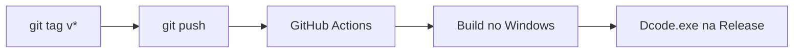

<div align="center">

# Dcode

**Ferramenta experimental de desktop para testar codificações e cifras clássicas.**

[](https://github.com/MaskDMoa/Dcode/releases)
[](https://github.com/MaskDMoa/Dcode/releases)
[](#testar-no-windows)
[](https://www.python.org/)

[](https://github.com/MaskDMoa/Dcode/actions)
[](https://github.com/MaskDMoa/Dcode/commits)
[](https://github.com/MaskDMoa/Dcode/issues)
[](https://github.com/MaskDMoa/Dcode/stargazers)

<a href="https://github.com/MaskDMoa/Dcode/releases"> Baixar</a>
&nbsp;&nbsp;|&nbsp;&nbsp;
<a href="#gerar-o-executavel"> Compilar</a>
&nbsp;&nbsp;|&nbsp;&nbsp;
<a href="https://github.com/MaskDMoa/Dcode/issues"> Reportar bug</a>
&nbsp;&nbsp;|&nbsp;&nbsp;
<a href="#contribuindo"> Contribuir</a>

</div>

---

<a id="sumario"></a>
##  Sumário

- [Sobre](#sobre)
- [Recursos](#recursos)
- [Prévia](#previa)
- [Testar no Windows](#testar-no-windows)
- [Gerar o executável a partir do código](#gerar-o-executavel)
- [Releases automáticas](#releases-automaticas)
- [Aviso de segurança](#aviso-de-seguranca)
- [Contribuindo](#contribuindo)
- [Licença](#licenca)
- [Autor](#autor)

---

<a id="sobre"></a>
##  Sobre

O **Dcode** é um aplicativo de desktop criado para **experimentar, estudar e
entender** codificações e cifras clássicas de forma prática, direto no
computador, sem depender de sites de terceiros.

É um projeto **experimental e didático**: ótimo para aprender como cada
técnica transforma um texto, mas **não** para proteger dados reais.

<a id="recursos"></a>
##  Recursos

-  **Aplicativo desktop** com interface gráfica
-  **Executável portátil** para Windows: sem instalador e sem Python
-  **Base64**: codificação e decodificação de texto
-  **Vigenère**: cifra clássica com chave
-  **Build automatizado** com GitHub Actions a cada nova tag

<a id="previa"></a>
##  Prévia

> Adicione aqui uma captura de tela do aplicativo.
> Salve a imagem em `docs/screenshot.png` e troque este bloco por:
>
> ```markdown
> 
> ```

<a id="testar-no-windows"></a>
##  Testar no Windows

1. Acesse a página de [**Releases**](https://github.com/MaskDMoa/Dcode/releases).
2. Baixe o arquivo **`Dcode.exe`** da versão mais recente.
3. Dê dois cliques para executar.

> [!NOTE]
> O executável é **portátil**: não é um instalador e **não exige Python**.
> Se o Windows SmartScreen exibir um alerta, clique em **Mais informações →
> Executar assim mesmo** (o executável não é assinado digitalmente).

<a id="gerar-o-executavel"></a><a id="gerar-o-executavel-a-partir-do-codigo"></a>
##  Gerar o executável a partir do código

### Pré-requisitos

- Windows com **PowerShell**
- **Python 3** instalado e disponível no `PATH`
- **Git** (para clonar o repositório)

### Passo a passo

```powershell
# 1. Clone o repositório
git clone https://github.com/MaskDMoa/Dcode.git
cd Dcode

# 2. Instale as dependências de build
python -m pip install -r requirements-build.txt

# 3. Gere o executável
.\build.ps1
```

O arquivo será criado em **`dist\Dcode.exe`**.

<a id="releases-automaticas"></a>
##  Releases automáticas

Ao enviar uma tag no formato `v*`, o **GitHub Actions** compila o aplicativo
para Windows e publica o executável em uma Release automaticamente.

```bash
git tag v1.0.0
git push origin v1.0.0
```



<a id="aviso-de-seguranca"></a>
##  Aviso de segurança

> [!WARNING]
> - **Base64 é uma codificação, não criptografia.** Qualquer pessoa consegue
>   reverter o texto sem chave alguma.
> - **Vigenère é uma cifra clássica para fins didáticos.** Ela é facilmente
>   quebrada por criptoanálise moderna.
> - **Não use este aplicativo para proteger dados sensíveis**, como senhas,
>   documentos ou informações pessoais.

<a id="contribuindo"></a>
##  Contribuindo

Contribuições são muito bem-vindas!

1. Faça um **fork** do projeto
2. Crie uma branch: `git checkout -b feature/minha-ideia`
3. Faça o commit: `git commit -m "feat: adiciona minha ideia"`
4. Envie para o seu fork: `git push origin feature/minha-ideia`
5. Abra um **Pull Request**

Encontrou um problema ou tem uma sugestão? Abra uma
[issue](https://github.com/MaskDMoa/Dcode/issues).

<a id="licenca"></a>
##  Licença

Este projeto ainda não define uma licença. Para permitir uso e contribuições
de outras pessoas, adicione um arquivo `LICENSE` (por exemplo, MIT) à raiz
do repositório e atualize esta seção.

<a id="autor"></a>
##  Autor

Feito por **[MaskDMoa](https://github.com/MaskDMoa)**.

<div align="center">

 Se o projeto te ajudou, deixe uma estrela no repositório.

</div>
